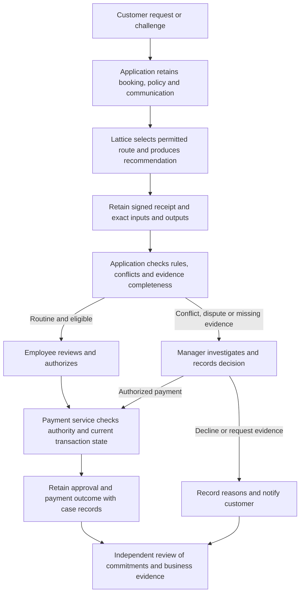

# C2 research and design for a travel refund dispute

**Recommendation:** use an **illustrative travel-refund review after conflicting chatbot advice**, motivated by *Moffatt v. Air Canada*, as the main business case. Use Klarna to establish the broader commercial relevance of AI-assisted refunds and Zurich as a contrasting claims-support application. None of these organizations is represented as a Lattice user.

**Status, November 3, 2026:** research/design and a live free-model demonstration are ready for author review. This remains a research brief, not manuscript prose or a company field study. C2 evidence is now integrated in the manuscript as a workflow figure and evidence/results tables; author narrative and review remain pending. A separate [AI-generated reference draft](C2-REFERENCE-DRAFT.md) is available for author rewriting, with [provenance](C2-INTEGRATION-PROVENANCE.md). Implementation mappings below were checked at repository revision `0c9f64f`.

**Execution update:** at the user's request, the [live refund demonstration](../../eval/refund/results/summary.md) ran eight synthetic scenarios through Lattice with two free models and two repetitions: 32/32 planned runs, 28/32 full-rubric passes, and 32/32 verified run-evidence packages. All decision fields and decisive-rule selections matched; the four strict failures omitted a required customer-request reference. The account-spend delta was USD 0. The [interpretation](../../eval/refund/results/interpretation.md) distinguishes live recommendations from simulated approvals/payments and identifies untested controls. Frozen measured revision: `f8a6914`. The design below is retained as the proposal; the results report governs claims about what was actually executed.

## Why this case is the strongest fit

The research question concerns evidence for organizational review. A disputed refund gives that review a recognizable owner, a customer with a concrete loss, conflicting records, and a decision that cannot be delegated to signature verification. It also continues C1's illustrative refund opening without requiring a new domain or private company data.

| Candidate and primary evidence | How Lattice could fit | Reason for the choice |
| --- | --- | --- |
| **Travel-refund dispute.** The 2024 *Moffatt* decision records conflicting chatbot and webpage guidance, a customer refund claim, and missing contractual evidence. [S1](#s1-tribunal-decision) | Bind the retained inputs, recommendation, task, and execution policy to a run; give a reviewer a portable record to check alongside company approval and payment evidence. | **Best main case:** an independently documented accountability problem; clear ordinary/exception paths; synthetic reproduction feasible before the draft cutoff. The judgment does not establish that cryptographic evidence would have changed the outcome. |
| **Commerce refunds and returns.** Klarna's August 2025 filing describes its AI assistant handling these tasks and retaining a human-support option. [S2](#s2-klarna-filing) | Link a recommendation to the order, return evidence, merchant policy, and review record across organizational boundaries. | Strong commercial corroboration. Public reporting does not expose enough case-level evidence to reproduce Klarna's process or assess its internal controls. |
| **Insurance claims support.** Zurich UK's claims chief describes AI-supported research and intelligence gathering while retaining claims handlers' judgment. [S3](#s3-zurich-claims-interview) | Preserve the policy, claim materials, findings and recommendation used by a handler. | Strong alternative, but coverage interpretation, fraud labels, sensitive records and expert validation add work. Less feasible than refunds for this submission. |

This ranking is a design judgment based on problem fit, access to evidence, and feasibility; it is not a quantitative comparison or evidence of adoption. A real FSB/Voyza deployment would need separately verified facts and rights-holder permission under A5.

## What the public evidence supports

In *Moffatt*, the chatbot allowed a retroactive request that the linked policy excluded. The tribunal held Air Canada responsible for its website information and noted the absence of the relevant tariff text. Screenshots and correspondence supported the decision. The ruling does not identify the chatbot's technical architecture or establish a tampering incident. [S1](#s1-tribunal-decision)

**Design implication:** retain the actual policy and customer communication, not just their identifiers, together with the recommendation and subsequent decisions. A receipt adds an integrity check for retained commitments; it cannot recover missing content or make inaccurate advice correct. Do not call this a demonstrated LLM hallucination, assume a retrieval failure, or claim Lattice would have prevented the dispute.

Klarna documents a real refund/return service application, while Zurich documents complementary roles for AI and employees. Their reports motivate relevance; their performance claims are not Lattice results and are not used as evaluation baselines. [S2](#s2-klarna-filing), [S3](#s3-zurich-claims-interview)

The proposed case connects to the special issue through human judgment, organizational accountability, contestability and enterprise integration. The call welcomes simulations and experiments as well as case studies. Describe our contribution as a **synthetic demonstration motivated by a documented dispute**, not an Air Canada deployment or field evaluation. [S4](#s4-special-issue-call)

## Proposed synthetic scenario

All names, amounts, rules, approvals and transaction states below are **invented fixtures for the proposed demonstration**. They do not describe any named company's policy or establish consumer entitlements under applicable law. Use a fictional travel provider; omit bereavement records, personal data and real company screenshots.

| Role | Responsibility in the proposed workflow |
| --- | --- |
| Customer | Supplies the booking reference and dispute evidence; can challenge a decision. |
| Service employee | Checks the source records, reviews the recommendation, and authorizes routine decisions within delegated limits. |
| Customer-service manager | Owns the review process and resolves policy/communication conflicts and service-recovery exceptions. |
| Policy owner | Maintains the applicable terms, version, effective period and approval history. |
| Application operator | Configures permitted providers, signing keys, evidence retention, access and export. |
| Finance/payment service | Executes an authorized refund using fresh transaction state and duplicate-payment controls. |
| Independent reviewer | Checks exported evidence using a separately obtained trusted public key, then assesses the decision and authorization records. |

**Fixture rules:** R1 permits a full refund for an unused flexible booking cancelled before departure. R2 excludes a routine voluntary refund for a basic non-refundable booking. R3 requires manager review when company advice conflicts with the applicable terms; a service-recovery manager may authorize a discretionary payment up to USD 300. An employee may authorize a routine refund up to USD 200. These are demonstration rules, not a regulatory model. No AI output itself authorizes payment.

The **business refund policy** is a versioned input artifact. Lattice's **execution policy** governs model/provider routing, privacy constraints and budget. `policyHash` commits to that execution-policy object; it is not automatically a commitment to the airline's refund terms or a test of legal compliance. Preserve the refund document separately and check its input hash.

### Ordinary path

1. A customer requests USD 180 for an unused flexible booking cancelled before departure. Intake records the case ID, booking state and request.
2. The application retrieves the applicable policy version and stores the exact booking, policy and cancellation evidence. Business identifiers and version/effective-date information belong inside hashed artifact values, not solely in unsigned metadata.
3. Lattice runs a recommendation task over these artifacts using a configured signer, an approved route and a structured output. The proposed output contains case ID, recommendation, requested amount, policy/source references, conflict flag and reason.
4. Application checks confirm booking identity, amount, cancellation eligibility and no prior refund. The employee reviews the sources and authorizes USD 180. These checks and human approval are application responsibilities.
5. The payment service rechecks current state, executes once, and records the transaction outcome. The evidence package retains the receipt, inputs, recommendation, review rationale and payment acknowledgment.
6. A reviewer checks the retained artifact/output hashes and expected execution bindings, then separately checks authority and payment evidence. Returning stored outputs is not model re-execution.

### Exception path and customer challenge

1. A basic booking has a USD 240 refund request and an earlier customer-service message promising a refund within 30 days. The applicable fixture policy conflicts with that message.
2. Preserve an initial **scripted, erroneous recommendation to reject** that cites R2 but ignores the conflict, plus a **simulated employee approval** of the rejection. This supplies the disputed decision in C1. Label both as fixtures, not observations of a model or employee.
3. The customer challenges the rejection. A new review receives the original case records, promise, recommendation and rejection, with a link to the earlier run. Link records explicitly in the application; do not imply that two `ai.run` calls automatically form a complete signed case history.
4. Under R3, the application requires manager review regardless of a model's confidence or citation formatting. The proposed review output identifies the conflict and recommends escalation. Source presence and schema checks cannot establish semantic correctness.
5. The scripted manager decision authorizes USD 240 as a service-recovery exception and records a reason. The application verifies the manager's authority and current payment state before the payment fixture executes. A separate case for missing authority must stop payment.
6. The reviewer can distinguish the original policy-based rejection, the ignored conflicting communication, and the later exception. A signature can validate the wrong recommendation's record while the business review finds the decision defective.

**Business objective:** make a contested decision reconstructable and assign each action to a responsible role. Reduced review effort, fewer disputes and improved customer outcomes are hypotheses for later evaluation.

## Proposed process figure

Figure status: AI-assisted design diagram in research notes, not empirical data. If adapted for the manuscript, document the assistance in the figure legend and confirm the specific model/version from the session record; the pooled author-reported model list does not identify this session. [S5](#s5-publisher-guidance)

## Evidence that each step needs

| Step and owner | Control and retained evidence | What can be checked | Remaining boundary |
| --- | --- | --- | --- |
| Intake — application | Case ID; booking snapshot; customer submission; capture time; expected evidence inventory | Compare artifact values with signed input hashes when included in the run | Does not establish source authenticity, complete capture, or trustworthy time |
| Policy selection — policy owner/application | Actual terms with version, scope, effective dates and approval provenance | Check the exact retained policy value against its input hash | Business applicability and policy-owner authority need separate evidence |
| Route and execution — Lattice/operator | Task, merged execution policy, catalog snapshot, plan, serialized request bodies where captured, receipt | Verify task/policy expectations, selected-route record and ordered request hashes when present | Route candidates/scores are outside the receipt; declared provider privacy behavior and remote consumption are not proven |
| Recommendation — Lattice/application | Exact output object, source references, contract declaration and verdict | Check output hash and the recorded contract result | `mustCite` checks citation presence/format, not factual support; a valid record can contain bad advice |
| Approval or escalation — employee/manager/application | Authenticated actor, delegated authority, decision, reason, time, case and recommendation references | Application checks that the approval belongs to this decision and the actor had authority | A runtime signature is not an employee signature; authorization is outside the standard receipt |
| Payment — finance service | Current transaction state, idempotency record, request and outcome, authorization link | Reconcile the case with payment-system records | A signed model recommendation is neither payment authorization nor proof of settlement |
| Review — independent reviewer | Trusted key set, receipt, exact artifact/output bytes, expected bindings and expected case inventory | Distinguish signature failure, content mismatch, missing evidence and business-rule error | A valid receipt alone cannot reveal a never-recorded event, a dishonest issuer or a missing approval |

Retain sensitive content in access-controlled storage and export only what the review requires. Unsalted hashes are not encryption or anonymization. A mutable URL or document ID is insufficient: preserve the exact content that was supplied.

## Mapping to the existing implementation

| Case requirement | Source inspected | Implementation consequence |
| --- | --- | --- |
| Produce a signed terminal record | [`maybeIssueReceipt`](../../packages/lattice/src/runtime/create-ai.ts), [`PolicySpec`](../../packages/lattice/src/policy/policy.ts) | Configure a signer; check `receiptError` or use the documented throw mode. The payment boundary must stop on missing required evidence; that is an application rule. |
| Bind actual policy and booking content | [`hashInputArtifacts` and `hashOutputForReceipt`](../../packages/lattice/src/receipts/hashes.ts), [`fingerprintArtifactValue`](../../packages/lattice/src/storage/fingerprint.ts) | Inputs hash artifact **values** in order; outputs hash `JSON.stringify(outputs)`. Task/policy hashes use canonical JSON instead. Preserve representation and order; do not use one hashing recipe for everything. Reject missing/empty required commitments in the case verifier. |
| Check task, execution policy and submissions | [`bindings.ts`](../../packages/lattice/src/receipts/bindings.ts), [`verifyReceipt`](../../packages/lattice/src/receipts/verify.ts), [`execution-binding.test.ts`](../../packages/lattice/src/runtime/execution-binding.test.ts) | Supply `expectedTaskHash`, `expectedPolicyHash` and, where available, `expectedProviderRequestHashes`. Schema version alone does not require these optional commitments. Expected values must come from retained expected records, not be copied from the receipt under test. |
| Treat submission evidence accurately | [`provider contract`](../../packages/lattice/src/providers/provider.ts), [`request hashing`](../../packages/lattice/src/providers/request.ts), [`receipt construction`](../../packages/lattice/src/runtime/create-ai.ts) | The request list exists only with complete callback coverage. It commits to prepared bodies, including failed attempts; it does not prove remote receipt or model consumption. Retain endpoint/header context separately if needed, without secrets. |
| Enforce output constraints without confusing them with judgment | [`invariants.ts`](../../packages/lattice/src/contract/invariants.ts), [`tripwire.ts`](../../packages/lattice/src/contract/tripwire.ts) | Schema/citation controls are useful checks; R1–R3 need explicit application rules and review. Do not credit Lattice with an unimplemented refund or approval engine. |
| Verify the exported case | [`materializeReplayEnvelope`](../../packages/lattice/src/replay/materialize.ts), [`replayOffline`](../../packages/lattice/src/replay/replay.ts) | Materialization verifies the receipt before loading but does not itself compare loaded artifact content hashes or enforce expected execution bindings. The case verifier must perform those checks and recompute the output hash explicitly. Offline return of stored output is not new inference. |

A single recommendation run is sufficient for the main path. Do not force a multi-agent crew into the case; it would add assumptions about tool effects and receipt completeness without resolving the business problem. Provider fallback can be a separate controlled variant with a clear operational reason.

## Demonstration specification for C4

Start with a deterministic **offline fixture** using real Lattice execution, hashing, signing and verification. Scripted provider outputs and employee/payment actions make it a mechanism demonstration, not a model-quality or practitioner evaluation. No live API call is needed. A later free-model cohort would be separate and would retain every outcome, including failures, under a frozen protocol.

Before execution, freeze the source revision, fixtures, business rules, expected evidence inventory, output contract and expected outcomes. Retain one case manifest with artifact roles and hashes, task, effective execution policy, captured requests, exact outputs, receipts, key-set provenance, application checks, simulated approvals and payment events. The manifest requires its own integrity/retention control; it does not become authenticated merely by accompanying a receipt.

| Planned check | Expected distinction, not a reported result |
| --- | --- |
| Routine eligible refund | Content/binding checks pass; an authorized fixture approves USD 180; payment fixture records one execution |
| Conflict review | R3 requires escalation; a manager decision records any discretionary USD 240 payment separately |
| Incorrect but signed rejection | Signature and output hash pass; business oracle identifies the ignored conflict; signature success must not count as decision-quality success |
| Edit the retained recommendation | Receipt signature can still pass; recomputed output hash must disagree |
| Substitute a policy version | Retained policy-value hash must disagree with the receipt; unchanged but inapplicable policy must instead fail the business applicability check |
| Alter task, execution policy or prepared request | Explicit expected-binding check rejects the mismatch |
| Remove a required artifact | Evidence-package check reports missing content, not an invalid signature |
| Omit approval or payment acknowledgment | Case inventory is incomplete even if all available run receipts verify |
| Forge a signature or use an untrusted key | Receipt verification fails against an independently trusted key set |
| No configured signer or signing failure | Application withholds authorization/payment until the required evidence is available |
| Valid record submitted for another case | Application checks case identity; audience/nonce expectations where configured; duplicate-payment protection remains external |
| Provider fallback | Separate fixture records failed and successful prepared attempts where callback coverage is complete; no claim that the first remote model consumed the request |

Compare the same fixtures in three configurations: (1) ordinary structured trace, (2) a properly protected append-only or signed record, and (3) Lattice receipts plus retained artifacts. Give each comparator the same inputs and threat assumptions. Distinguish post-record tampering, omitted evidence and dishonest initial recording. If the secured-log comparator is not implemented, report it as a design alternative, not an inferior measured baseline.

Useful measures: expected evidence items available, detected mutations by class, false rejection of intact records, correct business escalation under the fixture rules, exported bytes, and incremental evidence-processing time. Measure signing separately from model latency and storage/export work. Current historical benchmarks do not measure this proposed refund workflow. Claims about reviewer speed, confidence or customer outcomes require a distinct practitioner study or an explicit future-work note.

## Author incorporation and next actions

1. Authors confirm the case choice and write the original C2 narrative from the verified sources and their own argument. Place the business setting/actors before the artifact description and the executed demonstration in evaluation. Cross-reference the existing C1 opening.
2. Incorporate the completed live free-model demonstration and scoped offline controls from the linked report under C4, preserving all four source-reference omissions. The user's subsequent instruction authorized live calls instead of stopping at offline fixtures. Keep simulated review/authorization separate from human feedback; untested provider failover, real authorization and secured-log comparison remain outside this cohort.
3. Adapt the figure and evidence table with author review and accurate AI disclosure. C3 can then derive requirements for integrity, completeness, binding and review responsibilities; C5 can discuss key ownership, retention and escalation.
4. Keep the original-source and tool-use record. This brief provides research assistance and scenario design. Taylor & Francis prohibits AI first-drafting of manuscript sections; disclosure alone does not change that restriction. The previously identified AI-generated evaluation passages remain an A1 authorship-review item. [S5](#s5-publisher-guidance)

## Sources and exact locations

### S1 Tribunal decision

Civil Resolution Tribunal, *Moffatt v. Air Canada*, 2024 BCCRT 149, February 14, 2024, file SC-2023-005609. Paragraphs 14–17: chatbot characterization and conflicting advice; 20–23: correspondence; 27–32: responsibility and absent tariff evidence. The original [tribunal record](https://decisions.civilresolutionbc.ca/crt/crtd/en/item/525448/index.do) and [CanLII record](https://www.canlii.org/en/bc/bccrt/doc/2024/2024bccrt149/2024bccrt149.html) were inaccessible to the research tools. Read the primary decision in the [Middle Temple PDF copy](https://www.middletemple.org.uk/sites/default/files/civicrm/persist/contribute/files/2024bccrt149.pdf), also accessible through this [mirror of the decision](https://longangz.com/ai/case-documents/canada-moffatt-air-canada/source-1.pdf). This is a primary judgment hosted elsewhere, not reliance on the hosting firm's analysis. The original events were in 2022; the ruling was in 2024.

### S2 Klarna filing

Klarna Group plc, [Form F-1/A, amendment 2](https://www.sec.gov/Archives/edgar/data/2003292/000200329225000015/klarnagroupplcf-1a2.htm), filed August 14, 2025. Locate “Generative AI Streamlines the Consumer Experience and Reduces Our Costs” and “Customer Support”; the “dual-track approach” paragraph documents the human option. These are company disclosures, not independent validation. The launch press page was blocked, so the SEC filing is the substantive source.

### S3 Zurich claims interview

Zurich UK, [Q&A with James Nicholson, chief claims officer](https://www.zurich.co.uk/business-insurance/articles/q-a-james-nicholson-chief-claims-officer-zurich-uk), February 19, 2024. Locate the question about balancing technological and human claims functions; the response identifies the Xapien partnership and the claims-handler role. This is the executive's account, republished by Zurich from Insurance Post, not independent performance evidence.

### S4 Special issue call

Taylor & Francis, [The Post AI Enterprise](https://think.taylorandfrancis.com/special_issues/the-post-ai-enterprise/), accessed November 3, 2026. Scope paragraph on recommendations interacting with human judgment and institutional constraints; topics on governance, contestability and systems design; explicit welcome for simulations and experiments. The call does not establish acceptance of this particular demonstration or settle JITCAR's general author requirements under A7.

### S5 Publisher guidance

Taylor & Francis, [Using AI in research and manuscript preparations](https://authorservices.taylorandfrancis.com/editorial-policies/using-ai-in-your-research-and-manuscript-preparations/), accessed November 3, 2026. Relevant rows: first-draft manuscript text, idea exploration, process diagrams, software assistance and methodological records. Final author verification of originality, references, tool terms and declarations remains open.
